<picture>
  <source media="(prefers-color-scheme: dark)" srcset="metrics/banner-dark.svg">
  
</picture>

I write and package **free software**. Most of my time goes into mainline **Linux** and **Nura** (formerly postmarketOS) support for Qualcomm phones, Linux distribution tooling, and small, fast system services in **Rust** and **Go**. When something upstream breaks, I send the fix back. Over the years that has meant patches to the Linux kernel, Nura, systemd, LocalAI, ScummVM, DevilutionX and EasyEffects.

### What I work on

| Area | Highlights |
| :--- | :--- |
| **Kernel** | [**Linux mainline**](https://github.com/torvalds/linux/commits?author=M0Rf30): Qualcomm MSM8953/SDM630 device trees, PMI8950 PWM support in `leds-qcom-lpg`, a Novatek touchscreen fix · [**Nura**](https://gitlab.postmarketos.org/M0Rf30): `linux-postmarketos-qcom-msm8953` kernel upgrades, ALSA UCM audio profiles, `lk2nd-msm8953`, and the ports for the Xiaomi Redmi 5 Plus (vince) and Redmi Note 6 Pro (tulip) |
| **Artifacts** | [**OpenArtifact**](https://github.com/openartifact/openartifact): a self-hosted package registry for deb, rpm, apk, pacman, npm, PyPI, Maven, Docker, Helm, Cargo, Go, NuGet, RubyGems, Conda, Conan, Terraform, Nix, Ansible and raw files. Hosted, proxy and group repositories, vulnerability scanning with a local OSV mirror, SSO and federation; AGPL, one Go binary |
| **Packaging** | [**yap**](https://github.com/M0Rf30/yap): builds deb, rpm and apk packages from PKGBUILD specs · [**PKGBUILD**](https://github.com/M0Rf30/PKGBUILD): the Arch Linux recipes I maintain · [**android-udev-rules**](https://github.com/M0Rf30/android-udev-rules): one of the most comprehensive sets of Android udev rules around |
| **Rust** | [**rmpd**](https://github.com/M0Rf30/rmpd): an MPD server in pure Rust · [**netsukuku-rs**](https://github.com/M0Rf30/netsukuku-rs): a new implementation of the Netsukuku mesh network · [**opensubsonic-rs**](https://github.com/M0Rf30/opensubsonic-rs) · [**aulos**](https://github.com/M0Rf30/aulos): a music player for the COSMIC desktop |
| **Identity** | [**opencie**](https://github.com/M0Rf30/opencie): an app for signing and verifying documents with the Italian electronic ID card (CIE) · [**opencie-pkcs11**](https://github.com/M0Rf30/opencie-pkcs11): a cross-platform PKCS#11 library for the CIE |
| **Embedded** | [**simonpi**](https://github.com/M0Rf30/simonpi): runs Raspberry Pi images in QEMU · [**qemu-kernels-rpi**](https://github.com/M0Rf30/qemu-kernels-rpi): the matching QEMU kernel builds |
| **Media** | [**lactea**](https://github.com/M0Rf30/lactea): a MilkDrop 2/3 and projectM-compatible music visualizer in pure Rust on wgpu · [**easyeffects-presets**](https://github.com/M0Rf30/easyeffects-presets) · [**rivulet-engine**](https://github.com/rivulet-kodi/rivulet-engine) · [**shisper**](https://github.com/M0Rf30/shisper): subtitles generated with whisper.cpp |

<picture>
  <source media="(prefers-color-scheme: dark)" srcset="metrics/stats-dark.svg">
  
</picture>

<picture>
  <source media="(prefers-color-scheme: dark)" srcset="metrics/activity-dark.svg">
  
</picture>

<picture>
  <source media="(prefers-color-scheme: dark)" srcset="metrics/languages-dark.svg">
  
</picture>

<picture>
  <source media="(prefers-color-scheme: dark)" srcset="metrics/kernel-dark.svg">
  
</picture>

<picture>
  <source media="(prefers-color-scheme: dark)" srcset="metrics/notable-dark.svg">
  
</picture>

**Recently merged upstream**

<!-- recent-prs:start -->
- [openartifact/helm-charts#27](https://github.com/openartifact/helm-charts/pull/27) — openartifact: 0.12.0 (app 0.15.0) · 2026-10-30
- [openartifact/openartifact#335](https://github.com/openartifact/openartifact/pull/335) — chore(release): v0.15.0 · 2026-10-30
- [openartifact/openartifact#334](https://github.com/openartifact/openartifact/pull/334) — fix: post-refactor review findings (security, perf, ops, core, web) · 2026-10-30
- [openartifact/openartifact#333](https://github.com/openartifact/openartifact/pull/333) — refactor: format plugins, generic package tables, domain stores, web/worker roles and dedup (#332) · 2026-10-29
- [openartifact/openartifact#331](https://github.com/openartifact/openartifact/pull/331) — feat(composer): proxy and group repositories (#328) · 2026-10-29
- [openartifact/openartifact#330](https://github.com/openartifact/openartifact/pull/330) — feat(composer): hosted Composer repositories (#328) · 2026-10-28
<!-- recent-prs:end -->

<!-- updated:start -->
Cards regenerated daily by <a href=".github/workflows/metrics.yml">a GitHub Actions workflow</a> · last run 2026-10-30
<!-- updated:end -->

